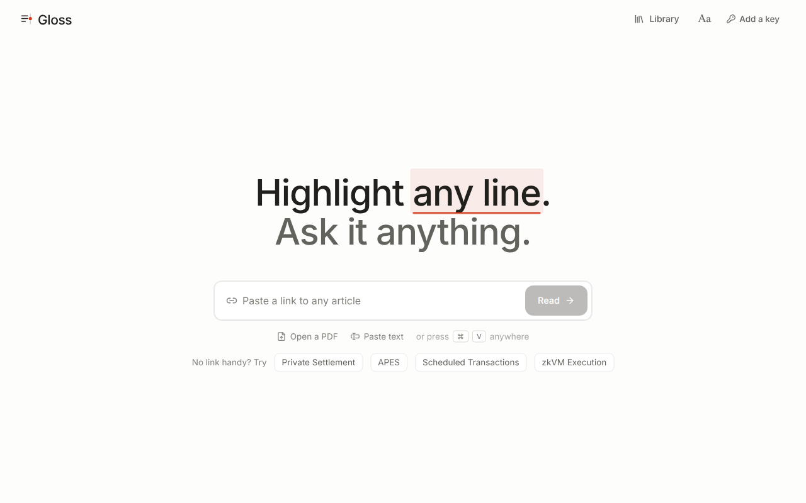
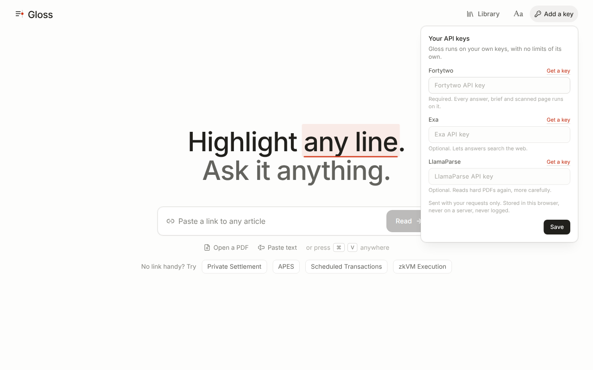
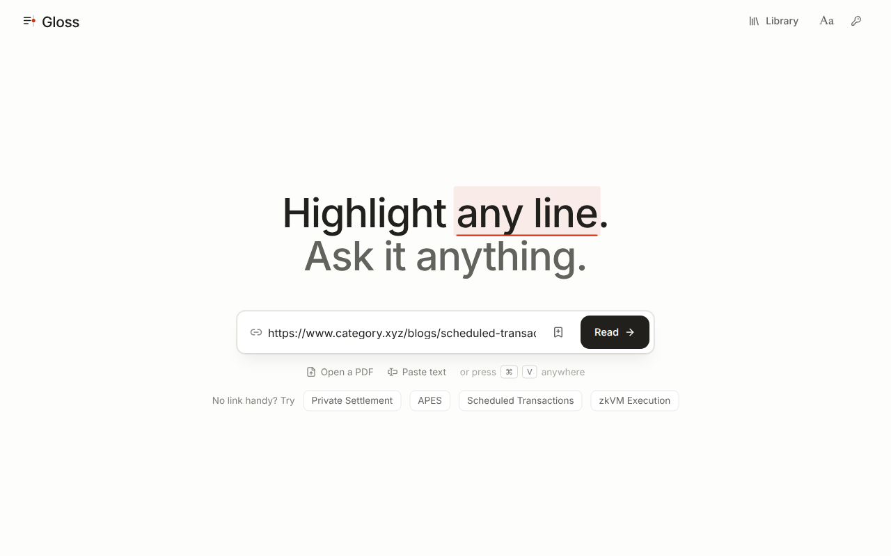
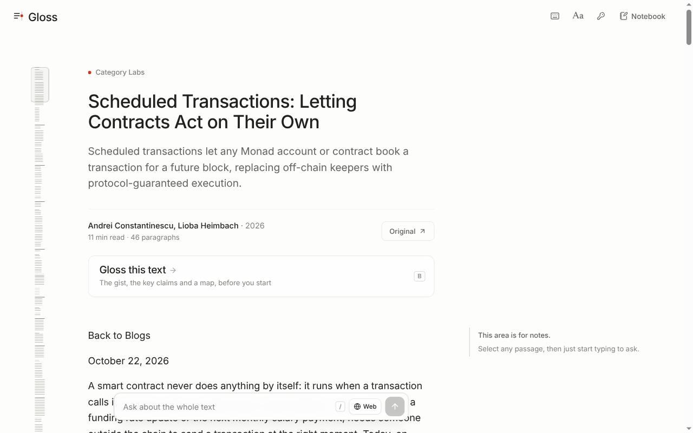
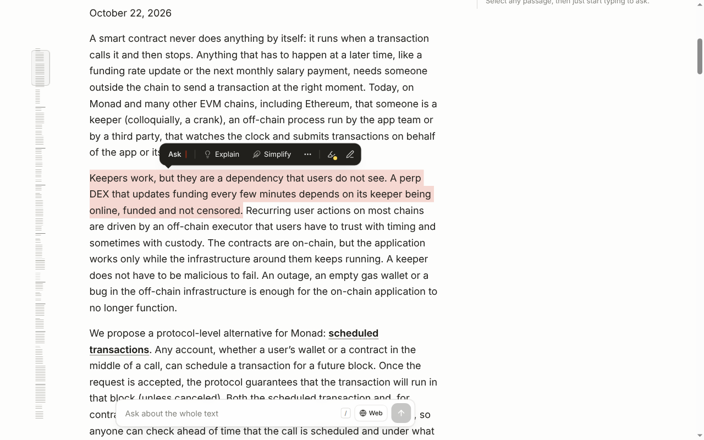
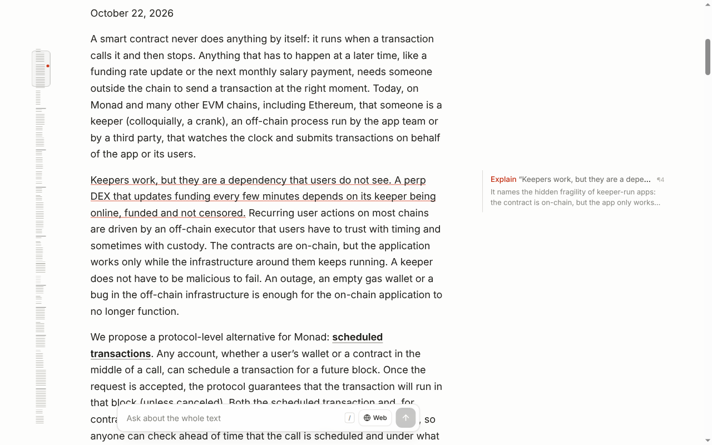
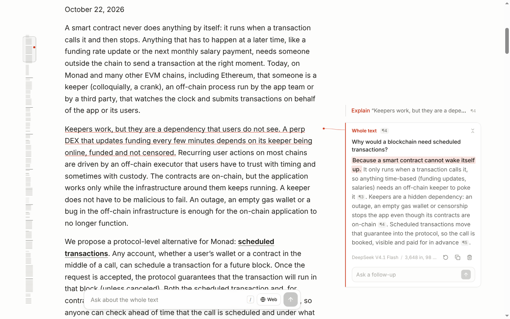
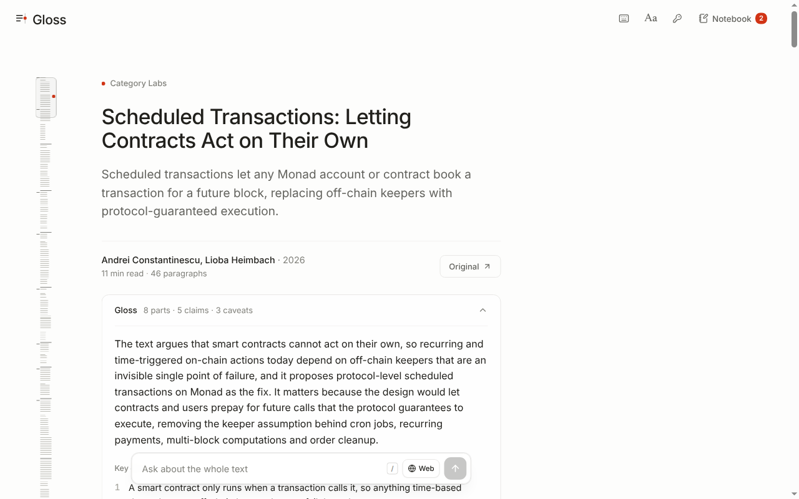
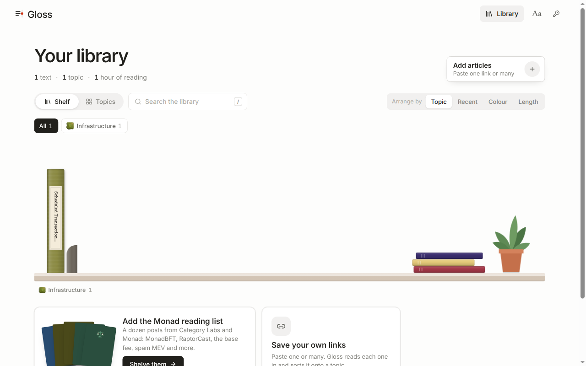

# Getting started with Gloss

Gloss helps you read. Open an article or a PDF, select any line, and ask about it. The answer appears in the margin, next to the text.

Try it at **[gloss-ruddy.vercel.app](https://gloss-ruddy.vercel.app)**. You don't need an account.

## 1. Open Gloss

The home page has one box. You paste a link into it.

## 2. Add your key

Gloss uses AI from [Fortytwo](https://fortytwo.network), so it needs your own Fortytwo key.

1. Click **Add a key** in the top right corner.
2. Click **Get a key** next to Fortytwo and create a key on the Fortytwo website.
3. Paste the key and click **Save**.

The other two keys are optional:

- **Exa** lets answers search the web.
- **LlamaParse** helps with PDFs that are hard to read.

Your keys are saved only in this browser. You add them once, and they are still there when you come back. You need to add them again in a different browser or device, or in a private window.

## 3. Open something to read

Paste a link to an article and click **Read**.

You can also:

- Click **Open a PDF** to read a PDF from your computer.
- Click **Paste text** to paste any text.
- Click one of the suggested posts under the box.

## 4. Read

Gloss shows the text cleanly, with no ads or pop-ups.

## 5. Select a line and ask

Select any words, a sentence or a paragraph. A small toolbar appears:

- **Ask**: type your own question.
- **Explain**: what it means, and why it is there.
- **Simplify**: the same idea in plain words.
- **···** (more): a counterpoint, a fact-check and more.

The answer appears in the margin. Click it to read it in full.

## 6. Ask about the whole text

Use the box at the bottom of the page to ask about the whole article. The answer shows which paragraphs it came from, like ¶4. Click one to jump there.

Turn on **Web** to let the answer search the internet. This needs an Exa key.

## 7. Get the gist first

Click **Gloss this text** at the top of the article. Gloss writes the main point, the key claims and a map of the text. This can take a minute or two.

Your highlights and answers are kept in the **Notebook**, in the top right corner.

## 8. Your library

Everything you open is saved in your **Library** and sorted by topic. Click **Library** at the top to see it.

On a new library, click **Shelve them** to add a reading list of a dozen Monad and Category Labs posts.

## Good to know

- **Private:** your keys, library, highlights and notes stay in your browser. Gloss has no accounts and no tracking.
- **One browser only:** what you save in one browser doesn't show up in another. Clearing your browser data deletes it.
- **Something went wrong?** Check that your Fortytwo key is saved: click the key icon in the top right corner.
