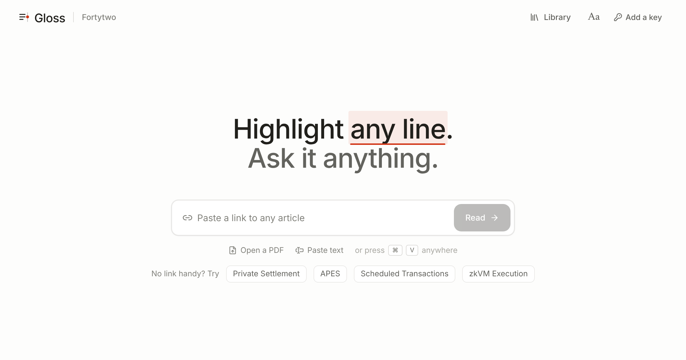

<a href="https://usegloss.io">
  
  <h1 align="center">Gloss</h1>
</a>

  An open source AI reader for articles and PDFs. Select any line, ask a question, and get a cited answer in the margin. Powered by [Fortytwo](https://fortytwo.network).

## Tech stack

- [DeepSeek V4.1 Flash](https://docs.fortytwo.network/docs/models) for the LLM
- [Fortytwo](https://docs.fortytwo.network) for LLM inference
- [Exa](https://exa.ai) for web search
- [LiteParse](https://github.com/run-llama/liteparse) for in-browser PDF parsing, with Nemotron 3.5 Super VL on Fortytwo for scanned pages
- [Clerk](https://clerk.com) for optional auth and [Neon](https://neon.tech) for syncing your library
- Next.js app router with Tailwind

## Cloning & running

1. Clone the repo: `git clone https://github.com/Nutlope/gloss`
2. Create a `.env.local` file (use `.env.example` for reference) and add your API keys:
   - **[Fortytwo API key](https://platform.fortytwo.network)**: `FORTYTWO_API_KEY=`
   - **Database URL** from [Neon](https://neon.tech): `DATABASE_URL=`
   - **Clerk keys** from [Clerk](https://clerk.com): `NEXT_PUBLIC_CLERK_PUBLISHABLE_KEY=` and `CLERK_SECRET_KEY=`
   - **Exa API key** (optional, for web search): `EXA_API_KEY=`
3. Run `npm install` and `npm run db:migrate` to install dependencies and create the tables
4. Run `npm run dev` and open http://localhost:3100

## Future Tasks

- [ ] Ship it as a browser extension that opens the same margin on any page
- [ ] Let a gloss compare two passages you pick at once
- [ ] Move the shared-key rate limit to a store like Upstash so it holds across instances
